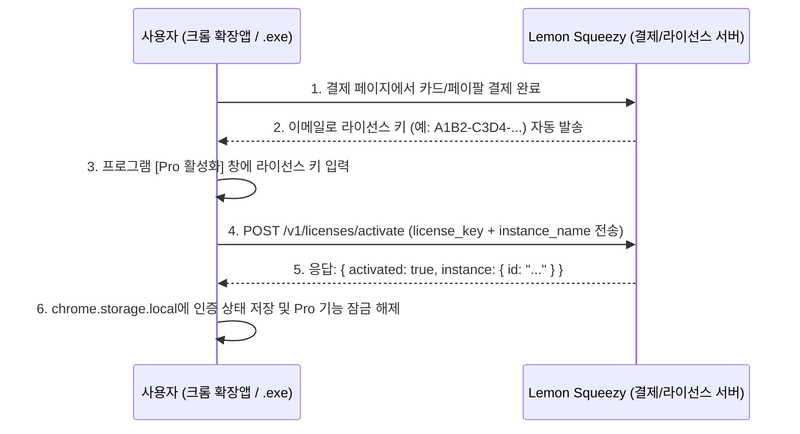
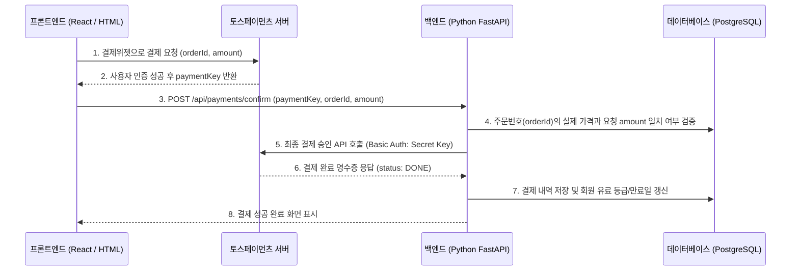

# 결제(Payment), 구독(SaaS), 라이선스 수익화 아키텍처 상세 가이드

- **기준일**: 2026-10-25
- **적용 대상**: 크롬 확장프로그램(MV3), 윈도우 데스크톱 앱(`Electron` / `Python .exe`), 웹 서비스(`FastAPI` / `React`), 안드로이드 모바일 앱(`Capacitor .apk`)에 유료 결제, 정기 구독, 시리얼 라이선스 키 인증을 연동하기 위한 기술 조합, 매칭 스킬/MCP 및 실전 구현 코드입니다.

---

## 1. 결제 시스템 3대 분류 핵심 비교

### 분류 1. 국내 PG (Payment Gateway — 토스페이먼츠, 포트원, KG이니시스 등)
- **핵심 특징**: 한국 사업자등록증이 필수이며, 국내 사용자가 가장 선호하는 신용카드, 카카오페이, 네이버페이, 토스페이, 가상계좌, 계좌이체를 제공합니다.
- **자체 백엔드 서버 필요 여부**: 필수입니다 (`FastAPI` 등에서 결제 금액 위변조 검증 및 최종 승인 API 호출 필요).
- **추천 적용 대상**: 국내 사용자 및 기업/기관 대상 웹서비스, 월 구독형 SaaS.

### 분류 2. 글로벌 MoR (Merchant of Record — Lemon Squeezy, Polar.sh, Paddle)
- **핵심 특징**: 전 세계 국가별 부가세(VAT) 신고와 환불 분쟁을 플랫폼이 100% 대행하며, 소프트웨어 시리얼 라이선스 키 자동 발급 및 기기 대수 제한 검증 API를 기본 내장하고 있습니다.
- **자체 백엔드 서버 필요 여부**: 불필요합니다 (무서버 구성 가능). 확장프로그램이나 `.exe` 클라이언트에서 라이선스 키 검증 API를 직접 호출할 수 있습니다.
- **추천 적용 대상**: 크롬 확장프로그램, `Electron`/`Python .exe` 설치형 유틸리티, 글로벌 유료 툴.

### 분류 3. 모바일 스토어 인앱결제 (IAP — Google Play Billing + RevenueCat)
- **핵심 특징**: 구글 플레이스토어 및 애플 앱스토어 출시 앱 내부에서 디지털 기능을 판매할 때 스토어 정책상 필수로 적용해야 하며, 복잡한 영수증 서버 검증과 구독 만료일 관리는 `RevenueCat`이 대행합니다.
- **자체 백엔드 서버 필요 여부**: 불필요합니다 (`RevenueCat` SDK가 구독 상태와 기기 변경 시 구매 복원을 관리).
- **추천 적용 대상**: 안드로이드 `.apk`/`.aab` 및 iOS 스토어 정식 출시 모바일 앱.

---

## 2. 프로그램 형태별 최적 결제 조합 및 [스킬 + MCP] 매칭

### 형태 1. 크롬 확장프로그램 (`WXT + Manifest V3`)
- **역할**: 구매자가 이메일로 발급받은 시리얼 키(`XXXX-YYYY-...`)를 확장앱 옵션/팝업에 입력하면 API가 키 유효성과 활성화 기기 대수(예: 최대 3대)를 즉시 검증하여 Pro 기능을 잠금 해제합니다.
- **조합**: `[기술스택] Lemon Squeezy (또는 Polar.sh) License API + chrome.storage.local + Zod` + `[짝꿍 스킬] wxt, chrome-mv3` + `[짝꿍 MCP] Lemon Squeezy MCP 또는 Polar.sh MCP`
- **명령**: `POST https://api.lemonsqueezy.com/v1/licenses/activate`

### 형태 2. 윈도우 데스크톱 앱 (`Electron / Tauri / Python .exe`)
- **역할**: 단품/연간 라이선스 판매 시 서버 없이 시리얼 키 활성화 방식으로 구동하며, 국내 기업 대상 월 정기구독일 경우 토스페이먼츠 빌링키를 FastAPI 서버와 연동합니다.
- **조합**: `[기술스택] Lemon Squeezy License API (무서버) 또는 Toss Payments Billing (FastAPI 연동)` + `[짝꿍 스킬] electron-architecture, fastapi-templates` + `[짝꿍 MCP] Lemon Squeezy MCP / Toss Payments MCP`
- **명령**: `npx -y @tosspayments/mcp`

### 형태 3. 국내 웹서비스 및 SaaS (`FastAPI + React / HTMX`)
- **역할**: 결제위젯 v2를 통해 카드 및 간편결제를 화면에 렌더링하고, FastAPI 백엔드에서 DB 주문 금액 대조 후 최종 결제 승인(`/v1/payments/confirm`)과 웹훅으로 회원 등급을 갱신합니다.
- **조합**: `[기술스택] 토스페이먼츠 v2 (Toss Payments) + FastAPI + PostgreSQL` + `[짝꿍 스킬] fastapi-templates, postgresql` + `[짝꿍 MCP] Toss Payments MCP (@tosspayments/mcp)`
- **명령**: `pnpm add @tosspayments/tosspayments-sdk`

### 형태 4. 국내 다중 PG 연동 및 휴대폰 본인인증
- **역할**: 토스뿐만 아니라 KG이니시스, NHN KCP, 나이스페이 등 복수 PG사를 동시에 연동하거나 회원가입 시 다날 휴대폰 본인인증을 함께 적용합니다.
- **조합**: `[기술스택] 포트원 V2 (PortOne V2) + FastAPI + React` + `[짝꿍 스킬] rest-api-design, fastapi-templates` + `[짝꿍 MCP] PortOne MCP (portone-mcp)`
- **명령**: `pnpm add @portone/browser-sdk`

### 형태 5. 안드로이드 모바일 앱 (`Capacitor .apk`)
- **역할**: 플레이스토어의 월간/연간 정기구독 상품 조회, 결제 처리, 기기 변경 시 구매 복원(Restore Purchases)을 처리합니다.
- **조합**: `[기술스택] Google Play Billing + RevenueCat + Capacitor` + `[짝꿍 스킬] capacitor-mobile-apps` + `[짝꿍 MCP] RevenueCat MCP (revenuecat-mcp)`
- **명령**: `pnpm add @revenuecat/purchases-capacitor`

---

## 3. 실무 구현 아키텍처 및 실전 코드

### 3.1. 패턴 A: 서버가 필요 없는 크롬 확장앱 / `.exe` 라이선스 키 검증 (`Lemon Squeezy`)
자체 회원 DB 서버를 24시간 운영할 필요가 없어 서버 유지비가 0원인 구조입니다.



#### [실전 코드] 크롬 확장프로그램 (`TypeScript + Zod`) 라이선스 활성화 및 7일 주기 자동 재검증

```typescript
// src/services/licenseService.ts
import { z } from 'zod';

const LicenseStorageSchema = z.object({
  isPro: z.boolean(),
  licenseKey: z.string(),
  instanceId: z.string(),
  lastValidatedAt: z.number(),
});

export type LicenseState = z.infer<typeof LicenseStorageSchema>;

const STORAGE_KEY = 'pro_license_state';
const REVALIDATE_INTERVAL_MS = 7 * 24 * 60 * 60 * 1000; // 7일 주기 백그라운드 재검증

// 1. 사용자가 입력한 라이선스 키 최초 활성화
export async function activateLicenseKey(
  licenseKey: string,
  deviceName = 'Chrome-Extension'
): Promise<{ ok: boolean; errorCode?: string }> {
  try {
    const response = await fetch('https://api.lemonsqueezy.com/v1/licenses/activate', {
      method: 'POST',
      headers: {
        Accept: 'application/json',
        'Content-Type': 'application/x-www-form-urlencoded',
      },
      body: new URLSearchParams({
        license_key: licenseKey.trim(),
        instance_name: deviceName,
      }),
    });

    const data = await response.json();
    if (!response.ok || !data.activated) {
      return { ok: false, errorCode: 'ERR_LICENSE_INVALID' };
    }

    const state: LicenseState = {
      isPro: true,
      licenseKey: licenseKey.trim(),
      instanceId: data.instance.id,
      lastValidatedAt: Date.now(),
    };
    await chrome.storage.local.set({ [STORAGE_KEY]: state });
    return { ok: true };
  } catch {
    return { ok: false, errorCode: 'ERR_NETWORK_FAILED' };
  }
}

// 2. Pro 여부 확인 (7일이 경과했으면 백그라운드에서 환불/만료 여부 재검증)
export async function checkProStatus(): Promise<boolean> {
  const raw = await chrome.storage.local.get(STORAGE_KEY);
  const parsed = LicenseStorageSchema.safeParse(raw[STORAGE_KEY]);
  if (!parsed.success || !parsed.data.isPro) return false;

  const state = parsed.data;
  if (Date.now() - state.lastValidatedAt < REVALIDATE_INTERVAL_MS) {
    return true;
  }

  try {
    const res = await fetch('https://api.lemonsqueezy.com/v1/licenses/validate', {
      method: 'POST',
      headers: {
        Accept: 'application/json',
        'Content-Type': 'application/x-www-form-urlencoded',
      },
      body: new URLSearchParams({
        license_key: state.licenseKey,
        instance_id: state.instanceId,
      }),
    });
    const data = await res.json();
    if (data.valid && data.license_key?.status === 'active') {
      await chrome.storage.local.set({
        [STORAGE_KEY]: { ...state, lastValidatedAt: Date.now() },
      });
      return true;
    }
    await chrome.storage.local.remove(STORAGE_KEY);
    return false;
  } catch {
    // 일시적 오프라인 상태일 때는 기존 정품 사용자의 편의를 위해 유예 허용
    return true;
  }
}
```

---

### 3.2. 패턴 B: 국내 웹서비스 정석 구조 (`FastAPI + 토스페이먼츠 v2 + PostgreSQL`)
프론트엔드에서 결제 금액을 임의로 변조하는 공격을 차단하기 위해, 프론트엔드 결제 인증 직후 반드시 백엔드(`FastAPI`)에서 DB 주문 금액과 대조한 뒤 최종 승인(`confirm`) API를 호출해야 합니다.



#### [실전 코드] FastAPI 토스페이먼츠 최종 결제 승인(`/api/payments/confirm`) 엔드포인트

```python
import base64
import os
import httpx
from fastapi import APIRouter, HTTPException
from pydantic import BaseModel

router = APIRouter(prefix="/api/payments", tags=["payments"])

TOSS_SECRET_KEY = os.getenv("TOSS_SECRET_KEY", "test_gsk_docs_OaPz8L5KdmQXkzRz3y47BMw6")

class PaymentConfirmRequest(BaseModel):
    paymentKey: str
    orderId: str
    amount: int

@router.post("/confirm")
async def confirm_toss_payment(req: PaymentConfirmRequest):
    # 1. [필수 보안] DB에 저장된 실제 주문 금액과 프론트에서 전달된 req.amount 일치 여부 검증
    # expected_amount = await get_order_amount_from_db(req.orderId)
    # if expected_amount != req.amount:
    #     raise HTTPException(status_code=400, detail="결제 금액 위변조가 감지되었습니다.")

    # 2. 시크릿 키 뒤에 콜론(:)을 붙여 Base64 인코딩 (토스페이먼츠 공식 규격)
    raw_key = f"{TOSS_SECRET_KEY}:".encode("utf-8")
    encoded_key = base64.b64encode(raw_key).decode("utf-8")

    headers = {
        "Authorization": f"Basic {encoded_key}",
        "Content-Type": "application/json",
    }

    # 3. 토스페이먼츠 최종 승인 API 호출
    async with httpx.AsyncClient(timeout=15.0) as client:
        res = await client.post(
            "https://api.tosspayments.com/v1/payments/confirm",
            headers=headers,
            json={
                "paymentKey": req.paymentKey,
                "orderId": req.orderId,
                "amount": req.amount,
            },
        )

    data = res.json()
    if res.status_code != 200:
        raise HTTPException(
            status_code=res.status_code,
            detail=data.get("message", "결제 승인에 실패했습니다."),
        )

    # 4. DB 결제 완료 처리 및 회원 등급 업그레이드 수행
    return {"status": "success", "receiptUrl": data.get("receipt", {}).get("url")}
```

---

## 4. 결제 관련 MCP 서버 10선 요약

### 001. Toss Payments MCP (`@tosspayments/mcp`) [국내PG / 프로젝트로컬]
- **역할**: 토스페이먼츠 최신 v2 규격 기준 프론트엔드 결제위젯 렌더링, 백엔드 `/confirm` 승인 검증, 정기결제 빌링키 및 웹훅 서명 검증 코드를 정확히 생성합니다.
- **조합**: `[기술스택] FastAPI + React + Toss Payments v2` + `[짝꿍 스킬] fastapi-templates` + `[짝꿍 MCP] Context7`
- **명령**: `npx -y @tosspayments/mcp`

### 002. Stripe Official MCP (`@stripe/mcp`) [글로벌PG / 프로젝트로컬]
- **역할**: 스트라이프 대시보드 접속 없이 대화만으로 요금제(Product/Price) 생성, 결제 링크 발급, 고객 결제 내역 조회 및 환불 처리를 수행합니다.
- **조합**: `[기술스택] Next.js / FastAPI + Stripe SDK` + `[짝꿍 스킬] stripe-integration` + `[짝꿍 MCP] Context7`
- **명령**: `npx -y @stripe/mcp --tools=all`

### 003. PortOne MCP (`portone-mcp`) [국내통합PG / 프로젝트로컬]
- **역할**: 포트원 V2 API 규격에 맞춰 카카오페이, 네이버페이, KG이니시스 통합 결제창 호출 코드와 다날 본인인증 및 웹훅 수신기를 생성합니다.
- **조합**: `[기술스택] FastAPI + React + PortOne V2` + `[짝꿍 스킬] rest-api-design` + `[짝꿍 MCP] Context7`
- **명령**: `npx -y portone-mcp`

### 004. Lemon Squeezy MCP (`lemonsqueezy-mcp`) [글로벌MoR / 프로젝트로컬]
- **역할**: 스토어 판매 현황, 발급된 라이선스 키 목록, 구매자별 키 활성화 횟수를 조회하고 확장프로그램용 라이선스 검증 모듈을 작성합니다.
- **조합**: `[기술스택] WXT + Chrome MV3 + Lemon Squeezy API` + `[짝꿍 스킬] wxt, chrome-mv3` + `[짝꿍 MCP] Context7`
- **명령**: `npx -y lemonsqueezy-mcp`

### 005. Polar.sh MCP (`@polar-sh/mcp`) [오픈소스MoR / 프로젝트로컬]
- **역할**: 개발자 친화적 MoR인 Polar에서 소프트웨어 릴리스 파일 업로드, 시리얼 라이선스 키 정책 설정, 구독자 혜택 연동을 자동화합니다.
- **조합**: `[기술스택] Electron / WXT + Polar SDK` + `[짝꿍 스킬] wxt, electron-architecture` + `[짝꿍 MCP] GitHub MCP`
- **명령**: `npx -y @polar-sh/mcp`

### 006. Paddle MCP (`@paddle/mcp`) [글로벌SaaS / 프로젝트로컬]
- **역할**: 글로벌 SaaS용 Paddle Billing의 구독 상태 변경, 세금 영수증(Invoice) PDF 추출, 결제 실패 고객 조회 및 웹훅 테스트를 수행합니다.
- **조합**: `[기술스택] FastAPI + React + Paddle Billing` + `[짝꿍 스킬] fastapi-templates` + `[짝꿍 MCP] Context7`
- **명령**: `npx -y @paddle/mcp`

### 007. PayPal Official MCP (`@paypal/mcp`) [글로벌결제 / 프로젝트로컬]
- **역할**: 해외 구매자용 페이팔 결제 버튼 연동, 이메일 청구서(Invoice) 발송, 거래 내역 검색 및 분쟁 상태를 확인합니다.
- **조합**: `[기술스택] React + FastAPI + PayPal SDK` + `[짝꿍 스킬] rest-api-design` + `[짝꿍 MCP] Context7`
- **명령**: `npx -y @paypal/mcp`

### 008. RevenueCat MCP (`revenuecat-mcp`) [모바일인앱결제 / 프로젝트로컬]
- **역할**: 안드로이드/iOS 앱의 인앱결제 상품(Offering) 구성을 확인하고 특정 모바일 유저의 구독 활성 상태와 만료일을 조회합니다.
- **조합**: `[기술스택] Capacitor + Google Play Billing + RevenueCat` + `[짝꿍 스킬] capacitor-mobile-apps` + `[짝꿍 MCP] Context7`
- **명령**: `npx -y revenuecat-mcp`

### 009. Gumroad MCP (`gumroad-mcp`) [디지털단품 / 프로젝트로컬]
- **역할**: 단건 판매한 유틸리티 프로그램이나 전자책의 시리얼 키 유효성 확인 API 연동 및 기간별 판매 수익 통계를 집계합니다.
- **조합**: `[기술스택] Python .exe / Electron + Gumroad License API` + `[짝꿍 스킬] python-packaging` + `[짝꿍 MCP] Context7`
- **명령**: `npx -y gumroad-mcp`

### 010. Shopify MCP (`@shopify/mcp`) [이커머스 / 프로젝트로컬]
- **역할**: 실물 하드웨어 장비나 부품 쇼핑몰 운영 시 상품 등록, 재고 수량 동기화, 주문서 확인을 자동화합니다.
- **조합**: `[기술스택] Shopify Storefront API + React` + `[짝꿍 스킬] frontend-design` + `[짝꿍 MCP] Context7`
- **명령**: `npx -y @shopify/mcp`
