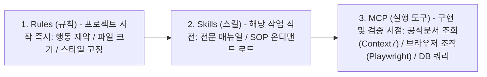
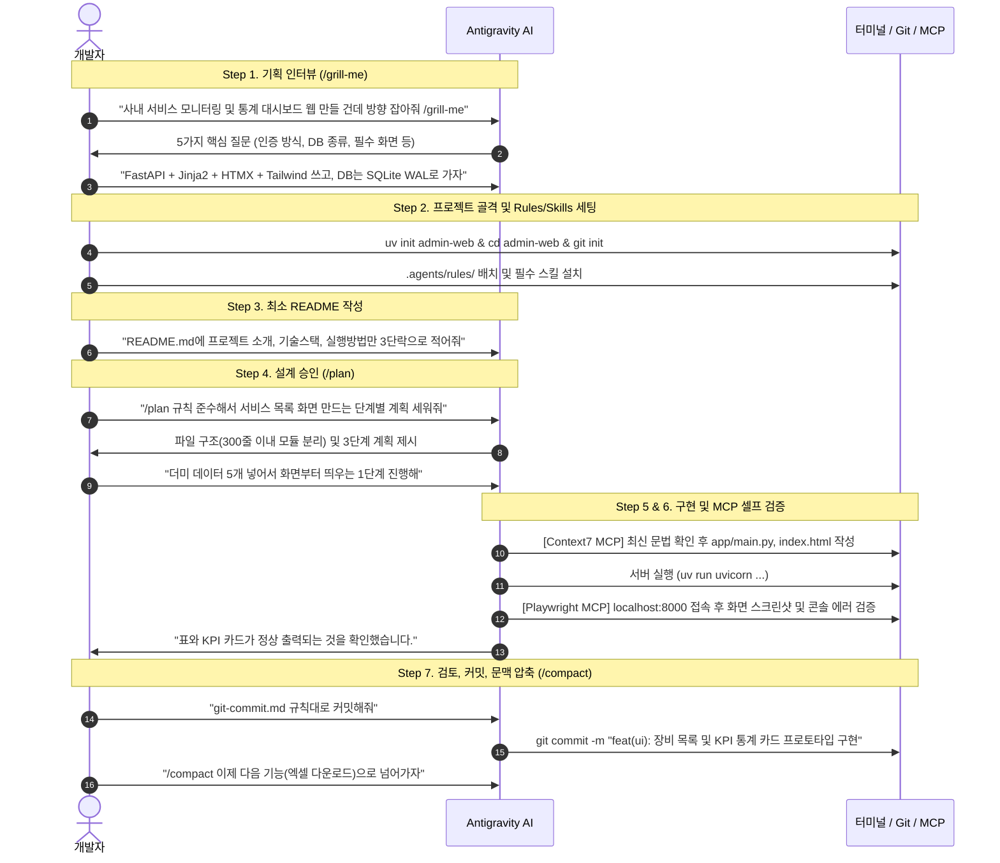

# 실전 바이브 코딩(Vibe Coding) 워크플로우 및 규칙(Rules) 설계 가이드

- **기준일**: 2026-10-25
- **짝꿍 스킬**: `agy-customizations`, `impl-validator`, `git-advanced-workflows`
- **적용 대상**: 신규 프로젝트를 시작할 때 ① `.agents/rules/` 규칙 파일의 표준 분리 설계와 작성 템플릿, ② Rules, Skills, MCP의 투입 시점, ③ 기획 인터뷰(`/grill-me`)부터 설계(`/plan`), 프로토타입 구현, MCP 셀프 검증, 커밋, 대화 압축(`/compact`)까지 이어지는 실전 1사이클 워크플로우 지침서입니다.

---

## 1. 바이브 코딩(Vibe Coding) 핵심 원칙 비교

- **기획 단계**:
  - 비효율적 방식: 처음부터 완벽한 명세서를 혼자 작성하느라 시간을 소모함
  - 바이브 코딩 표준: 핵심 아이디어만 제시하고 `/grill-me`로 AI가 역질문하게 하여 요구사항의 빈틈을 확정함
- **규칙(Rules) 관리**:
  - 비효율적 방식: 긴 줄글로 작성하여 AI가 핵심 제약을 놓침
  - 바이브 코딩 표준: `.agents/rules/`에 역할별로 파일을 분리하고 `[필수/금지]` 목록 형태로 명확히 규정함 (단일 파일 300~500줄 제한 포함)
- **README 관리**:
  - 비효율적 방식: 첫날부터 방대한 문서를 작성하여 실제 코드와 괴리가 발생함
  - 바이브 코딩 표준: 초기에는 3단락(소개, 기술스택, 실행법)만 작성하고 기능 완성 시점에 맞춰 동기화함
- **설계 및 구현**:
  - 비효율적 방식: 설계 검토 없이 즉시 코드를 생성하게 하여 스파게티 코드가 발생함
  - 바이브 코딩 표준: `/plan` 명령어로 생성/수정할 파일 트리와 모듈 분리 계획을 먼저 승인한 뒤 단계별로 구현함
- **검증 및 테스트**:
  - 비효율적 방식: 사람이 직접 브라우저를 켜고 에러 메시지를 복사해 전달함
  - 바이브 코딩 표준: `Playwright MCP`와 `PostgreSQL/SQLite MCP`를 통해 AI가 직접 화면 렌더링과 쿼리 결과를 자율 검증함
- **대화 문맥 관리**:
  - 비효율적 방식: 하나의 대화창에서 수십 개의 기능을 이어가 컨텍스트가 비대해짐
  - 바이브 코딩 표준: 기능 1개가 완료되어 Git 커밋을 마칠 때마다 `/compact`로 문맥을 압축하고 다음 기능으로 넘어감

---

## 2. `.agents/rules/` 디렉터리 표준 구성 및 템플릿

프로젝트 루트 아래 `.agents/rules/` 폴더를 생성하고 아래 5개 파일로 책임을 분리합니다.

```plaintext
내_프로젝트/
├── AGENTS.md                    # 프로젝트 전체 개요 및 아키텍처 요약
└── .agents/
    ├── rules/
    │   ├── common.md            # [상시] 언어, 도구(uv/pnpm), 엑셀/CSV 표준
    │   ├── code-architecture.md # [구조] 파일 비대화 방지(300~500줄 상한), 계층 분리
    │   ├── git-commit.md        # [깃 작업] Conventional Commits (<type>(<scope>): 한글요약)
    │   ├── secure.md            # [보안/데이터] 비밀키 보호, 위험 명령어 차단
    │   └── testing.md           # [테스트] pytest/Playwright, Mock 원칙
    └── skills/                  # 프로젝트 전용 로컬 스킬 폴더
```

### 2.1. `.agents/rules/common.md` (공통 개발 환경 및 서식)
```markdown
# 공통 개발 규칙 (Common Rules)

## 1. 언어 및 커뮤니케이션
- 사용자와의 모든 대화, 코드 주석, 에러 메시지 번역, 보고서 문서는 한국어를 기본으로 한다.
- 요청이 모호하거나 여러 기술적 갈래가 있을 때는 임의로 추측하지 말고 질문을 통해 의도를 확인한다.
- 불필요한 서론을 줄이고 실행 가능한 코드와 핵심 결론 위주로 간결하게 답변한다.

## 2. 패키지 및 환경 도구
- Python 프로젝트는 구형 pip, venv 대신 반드시 uv (uv add, uv run)를 사용한다.
- 크롬 확장프로그램 및 모노레포 웹 프로젝트는 pnpm + WXT + TypeScript(strict: true)를 사용한다.
- 윈도우 환경(PowerShell) 호환성을 항상 고려한다 ([Console]::OutputEncoding = [System.Text.Encoding]::UTF8).
- 기존 코드 수정 시 연관 없는 주석이나 함수를 임의로 삭제하지 않는다.

## 3. 엑셀/데이터 파일 기본 서식
- 엑셀(.xlsx) 생성 시 기본 행높이 25, 맑은 고딕 10pt, 제목 굵게(#D9E1F2), 모든 테두리(#BFBFBF), 틀고정(A2)을 기본 적용한다.
- CSV 입출력 시 엑셀 한글 깨짐 방지를 위해 utf-8-sig를 기본 인코딩으로 사용한다.
```

### 2.2. `.agents/rules/code-architecture.md` (코드 모듈화 및 비대화 방지)
```markdown
# 코드 모듈화 및 파일 비대화 방지 규칙 (Code Architecture)

## 1. 파일 및 함수 라인 수 상한선
- UI 컴포넌트 (.tsx, .vue, .html): 권장 300행 이내 (최대 500행 초과 금지 -> 서브 컴포넌트 및 커스텀 훅으로 분리)
- 비즈니스/서비스 로직 (.ts, .py): 권장 250행 이내 (최대 400행 초과 금지 -> 도메인별 유틸리티/서비스 모듈로 분리)
- 단일 함수 본문: 권장 50행 이내 (최대 100행 초과 시 내부 헬퍼 함수로 추출)

## 2. 계층별 책임 분리 (Separation of Concerns)
- components/: 순수 UI 렌더링 및 인터랙션
- hooks/: 상태(useState), 부수효과(useEffect), 단축키/이벤트 리스너 캡슐화
- services/: 외부 API, 백그라운드 메시징, DB/AI 연동
- utils/: 순수 계산 함수 (Canvas 연산, 좌표 변환, 포맷팅)
```

### 2.3. `.agents/rules/git-commit.md` (Git 커밋 컨벤션)
```markdown
# Git 커밋 규칙 (Git Commit Convention)

## 1. 커밋 메시지 포맷
커밋 메시지는 항상 아래의 Conventional Commits 형식을 따른다:
<type>(<scope>): <간결한 한 줄 요약 (한국어)>

## 2. 허용되는 Type 목록
- feat: 새로운 기능 추가 (예: feat(api): 사용자 인증 JWT 토큰 갱신 추가)
- fix: 버그 수정 (예: fix(popup): 미디어 스트림 오류 해결)
- docs: README, 문서 수정
- refactor: 기능 변경 없는 코드 구조 개선 및 파일 분리
- perf: 성능 및 메모리 최적화
- style: 코드 포맷팅, 세미콜론 등
- test: 테스트 코드 추가 및 수정
- chore: 빌드 업무, 패키지 매니저 설정, .gitignore 수정 등

## 3. 금지 사항
- 한 커밋에 여러 독립적인 작업을 섞지 말고, 기능 단위로 분리하여 커밋한다.
- 빌드 산출물(.output/, .wxt/, dist/, node_modules/, .venv/), 대용량 덤프(.bin, .pcap), .env는 커밋에 절대 포함하지 않는다.
```

### 2.4. `.agents/rules/secure.md` (보안 및 데이터 보호)
```markdown
# 보안 및 안전 규칙 (Security & Safety)

## 1. 민감 정보 노출 금지
- API 키, DB 비밀번호, 서명 비밀키(.pem)는 소스코드에 하드코딩하지 말고 .env에서 불러오도록 작성한다.
- .env.example 템플릿만 깃에 올리고, 실제 .env는 반드시 .gitignore에 등록되었는지 검증한다.

## 2. 데이터베이스 및 쿼리 안전
- 사용자 입력을 처리할 때 문자열 포맷팅(f"SELECT * FROM ... WHERE id = '{user_input}'")을 절대 금지한다.
- 반드시 파라미터화된 쿼리(Prepared Statement)나 ORM(SQLAlchemy 2.0)을 사용한다.
- DROP TABLE, TRUNCATE, rm -rf 같은 파괴적인 명령어는 사용자에게 명시적으로 승인받기 전엔 실행하지 않는다.
```

### 2.5. `.agents/rules/testing.md` (테스트 코드 원칙)
```markdown
# 테스트 규칙 (Testing Rules)

## 1. 테스트 실행 도구
- Python 백엔드 테스트는 uv run pytest로 실행한다.
- 웹/확장앱 UI E2E 테스트는 Playwright (npx playwright test) 또는 Playwright MCP로 검증한다.

## 2. 테스트 작성 원칙
- 실제 운영 DB나 외부 API/장비 TCP 소켓을 직접 호출하지 말고 Mock(unittest.mock)을 사용한다.
- 성공 케이스뿐만 아니라 잘못된 입력(빈 값, 비정상 위경도 좌표, 제한 페이지 chrome://, 연결 타임아웃)에 대한 실패 케이스를 1개 이상 작성한다.
```

---

## 3. Rules, Skills, MCP의 투입 시점과 역할 분담



---

## 4. 실전 바이브 코딩 "완전한 1사이클" 7단계 워크플로우



---

## 5. 단계별 실전 복붙 프롬프트 모음

### 5.1. 프로젝트 시작 시 (기획 구체화)
```text
[만들고 싶은 프로그램 아이디어 2~3줄 요약]
이 프로젝트의 기술 스택과 아키텍처를 결정하려고 해. 내가 놓치고 있는 요구사항이나 결정해야 할 핵심 질문 5가지만 해줘. /grill-me
```

### 5.2. 기능 구현 시작 전 (설계도 검토)
```text
/plan .agents/rules/ 안의 규칙(파일 크기 제한 및 계층 분리)을 준수하면서, [구현할 기능 이름] 기능을 구현하기 위한 단계별 계획과 생성/수정할 파일 목록을 정리해줘.
```

### 5.3. 화면 구현 후 (Playwright MCP 셀프 검증 지시)
```text
서버를 실행하고 Playwright MCP를 사용해서 http://localhost:8000 에 접속해봐. 상단 KPI 카드와 장비 목록 표가 정상적으로 렌더링되는지 스크린샷을 확인하고, F12 콘솔 에러가 있다면 직접 수정한 뒤 최종 결과를 알려줘.
```

### 5.4. 기능 완료 후 커밋 및 문맥 압축
```text
.agents/rules/git-commit.md 규칙(<type>(<scope>): <한글 요약>)에 맞춰 방금 작업한 내용을 커밋해줘.
(커밋 완료 후)
/compact
이제 다음 단계인 [다음 기능 이름] 작업으로 넘어가자.
```
