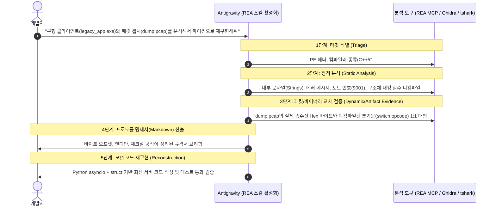

# AI 에이전트 개인 지식 위키(`LLM Wiki`) 자동 구축 및 바이너리/패킷 역공학(`REA`) 실무 가이드

- **기준일**: 2026-10-25
- **현재 PC 실제 설치 완료 스킬**:
  - **LLM Wiki 및 지식 수집 스킬군 (글로벌 설치 완료)**: `llm-wiki`, `wiki-agent`, `wiki-setup`, `wiki-ingest`, `wiki-research`, `wiki-synthesize`, `wiki-query`, `wiki-lint`, `wiki-dashboard`, `wiki-export`, `memory-bridge`, `obsidian-wiki-ingest`, `claude-history-ingest`, `codex-history-ingest`, `copilot-history-ingest`, `cross-linker`, `tag-taxonomy`, `data-ingest`, `ingest-url`
  - **역공학 스킬 (워크스페이스 로컬 설치 완료)**: `reverse-engineer-anything` (`morluto/rea`)
- **짝꿍 MCP**: `Sequential Thinking` + `REA MCP` (`rea`) + `Context7`
- **적용 대상**: 내 PC에 설치된 `LLM Wiki` 스킬 생태계로 흩어진 기술 명세서, 매뉴얼, AI 대화 기록을 구조화된 마크다운 지식 위키로 통합하는 방법과, `REA(Reverse Engineer Anything)` 스킬 및 MCP로 소스코드 없는 구형 `.exe`/`.dll`이나 미공개 통신 패킷(`.pcap`, `.bin`)을 역공학 분석하여 최신 코드로 재구현하는 실무 가이드입니다.

---

## Part 1. `LLM Wiki` 스킬 생태계를 활용한 기술 위키 자동화

### 1.1. `LLM Wiki` 전체 파이프라인 구조도

```mermaid
flowchart LR
    subgraph Input["1단계: 다양한 원본 자료 수집 (Ingest)"]
        I1["PDF 기술 명세서 / 엑셀 / 워드 (data-ingest, pdf, docx)"]
        I2["기술 블로그 / 웹 문서 URL (ingest-url)"]
        I3["과거 AI 채팅 히스토리 (claude / codex / copilot-history-ingest)"]
        I4["기존 옵시디언 볼트 (obsidian-wiki-ingest)"]
    end

    subgraph Core["2단계: 위키 구조화 및 지식 합성 (Synthesize)"]
        C1["wiki-ingest / wiki-capture (표준 마크다운 변환 및 분류)"]
        C2["cross-linker & tag-taxonomy (양방향 [[링크]] 및 태그 표준화)"]
        C3["wiki-synthesize & wiki-research (복수 문서 교차 분석 후 종합 문서 생성)"]
    end

    subgraph Maintain["3단계: 품질 검수 및 활용 (Query & Maintain)"]
        M1["wiki-lint & wiki-dedup (깨진 링크 수리 및 중복 문서 병합)"]
        M2["wiki-query & wiki-context-pack (질문 답변 및 코딩용 컨텍스트 추출)"]
        M3["memory-bridge (세션 간 핵심 결정사항 영구 기억)"]
    end

    Input --> Core --> Maintain
```



### 1.2. 작업 목적별 주요 위키 스킬 및 실행 프롬프트

#### 1) 새 지식 위키 폴더 최초 구축 (`wiki-setup`, `llm-wiki`)
- **역할**: 빈 폴더에 표준 디렉터리 구조, 인덱스 파일, 태그 분류 체계를 자동 생성합니다.
- **프롬프트**: `"현재 폴더에 llm-wiki 스킬 규칙을 따라서 API 명세서와 운영 트러블슈팅 이력을 관리할 기술 위키 구조를 초기 세팅해 줘 (wiki-setup)."`

#### 2) PDF 명세서 및 매뉴얼을 위키 문서로 변환 (`wiki-ingest`, `data-ingest`, `pdf`)
- **역할**: 대용량 PDF나 워드 문서에서 핵심 테이블과 프로토콜 규칙을 추출하여 마크다운 위키 문서로 편입합니다.
- **프롬프트**: `"이 폴더의 protocol_spec_2026.pdf에서 메시지 타입별 패킷 구조와 상태 코드 규칙을 추출해서 위키에 새 문서로 인제스트(wiki-ingest)해 줘."`

#### 3) 웹페이지 및 기술 문서 URL 수집 (`ingest-url`)
- **역할**: 외부 기술 문서나 공식 가이드 웹페이지를 클린 마크다운으로 변환하여 위키 카테고리에 저장합니다.
- **프롬프트**: `"이 URL(https://...)의 내용을 ingest-url 스킬로 추출해서 우리 위키의 네트워크 트러블슈팅 카테고리에 추가해 줘."`

#### 4) AI 대화 중 해결한 노하우 즉시 갈무리 (`wiki-quick-chat-capture`, `claude-history-ingest`)
- **역할**: 디버깅 중 발견한 원인과 해결책을 잊어버리지 않도록 위키 문서로 즉시 박제합니다.
- **프롬프트**: `"방금 우리가 해결한 비동기 스트림 청크 파싱 방법과 원인을 wiki-quick-chat-capture 스킬로 위키에 기록해 둬."`

#### 5) 문서 간 양방향 링크 연결 및 무결성 검수 (`cross-linker`, `wiki-dedup`, `wiki-lint`)
- **역할**: 위키 전체 문서를 스캔하여 연관 개념끼리 `[[문서명]]` 양방향 링크를 걸고 깨진 링크나 중복 문서를 정리합니다.
- **프롬프트**: `"위키 전체 문서를 검사해서 cross-linker로 연관 개념끼리 [[링크]]를 연결하고, wiki-lint로 깨진 링크나 중복 문서를 정리해 줘."`

#### 6) 코딩 시작 전 관련 위키 지식만 압축 추출 (`wiki-context-pack`, `wiki-query`)
- **역할**: 특정 기능을 구현하기 직전 위키 내에 축적된 관련 규격과 주의사항만 모아 컨텍스트 팩으로 제공합니다.
- **프롬프트**: `"지금 결제 웹훅 검증 모듈을 작성할 건데, 우리 위키에서 관련 규격과 주의사항만 뽑아서 wiki-context-pack으로 요약해 줘."`

---

## Part 2. `REA (Reverse Engineer Anything)` 기반 바이너리 및 패킷 역공학 가이드

소스코드가 유실된 구형 윈도우 `.exe`/`.dll` 프로그램이나 문서화되지 않은 바이너리 패킷(`.pcap`, `.bin`)을 분석하여 최신 파이썬/웹 코드로 재구현할 때 워크스페이스의 `reverse-engineer-anything` 스킬과 `rea` MCP 서버를 결합하여 사용합니다.

### 2.1. REA 역공학 분석 지원 타깃 범위
1. **Windows 네이티브 실행 파일 (`.exe`, `.dll`, `.sys`)**: C/C++/Delphi/MFC 등으로 빌드된 구형 클라이언트 프로그램, 패킷 시뮬레이터, 라이선스 검증 모듈
2. **닷넷(C#/.NET) 및 Java/Android (`.exe`, `.jar`, `.apk`)**: 관리형(Managed) 어셈블리 및 DEX 바이트코드 디컴파일을 통한 원본 수준 코드 복원
3. **파이썬 패키징 실행 파일 (`PyInstaller` `.exe`)**: 아카이브 추출 및 바이트코드 역분석을 통한 원본 파이썬 로직 복원
4. **Electron 및 크롬 확장앱 (`app.asar`, `.crx`)**: 번들 언패킹, 웹 모듈 임포트 추적 및 숨겨진 API/프로토콜 추출
5. **네트워크 패킷 및 바이너리 파일 (`.pcap`, `.bin`)**: `tshark` 헥사 스트림과 디컴파일된 파서 함수를 1:1 대조하여 바이트 오프셋 규격서 완성

---

### 2.2. 실전 역공학 5단계 표준 워크플로우 (Triage -> Static -> Dynamic -> Spec -> Reconstruct)



---

### 2.3. Windows PowerShell 기반 1차 바이너리 트리아지(Triage) 명령어

```powershell
# 1. 실행 파일(.exe/.dll)의 SHA256 해시값 및 파일 크기 확인
Get-FileHash .\legacy_client.exe -Algorithm SHA256
Get-Item .\legacy_client.exe | Select-Object Name, Length, LastWriteTime

# 2. 바이너리 내부에 포함된 ASCII 문자열(IP, 포트, 포맷 스트링, 함수명) 추출 (5글자 이상)
Select-String -Path .\legacy_client.exe -Pattern "[\x20-\x7E]{5,}" -AllMatches |
  ForEach-Object { $_.Matches.Value } | Select-Object -First 100

# 3. 바이너리 파일(.bin 또는 .exe)의 선두 128바이트를 Hex + ASCII 뷰어로 출력 (매직 바이트 확인)
Format-Hex -Path .\sample.bin -Count 128
```

---

### 2.4. REA 역공학 요청 시 사용하는 실전 프롬프트 3선

#### 프롬프트 1: 소스코드 없는 구형 `.exe` 프로그램의 통신 규격 해독 요청
```text
reverse-engineer-anything 스킬 절차를 따라서 현재 폴더의 [파일명.exe]를 분석해 줘.
1) 먼저 이 실행 파일이 어떤 언어/컴파일러(C++, C#, PyInstaller, Electron 등)로 빌드되었는지 식별(Triage)하고,
2) 네트워크 소켓 통신(송수신 포트, 패킷 헤더 매직 바이트, 명령 코드 분기, 체크섬 계산 공식)과 관련된 로직을 정적 분석해서 오프셋별 프로토콜 명세서로 정리해 줘.
```

#### 프롬프트 2: `.pcap` 패킷 캡처 파일과 `.bin` 바이너리 구조 역추적 요청
```text
현재 폴더의 [capture.pcap] 파일과 [sample.bin] 파일을 분석해서,
1) 헤더 바이트 오프셋별 필드 의미(매직바이트, 식별자, 길이 등)와 엔디안(Big/Little)을 검증하고,
2) 내부에 포함된 이미지/미디어 청크의 시작(FF D8 FF)과 끝(FF D9) 오프셋 구조를 파악한 뒤,
3) 이를 파싱하고 언패킹하는 Python 3.12 (struct 모듈 기반) 코드를 작성하고 실제 파일로 테스트해 줘.
```

#### 프롬프트 3: 구형 유틸리티를 최신 웹/데스크톱 앱으로 1:1 재구현(Reconstruction) 요청
```text
방금 역공학으로 밝혀낸 [프로그램명.exe]의 기능과 프로토콜 규격을 바탕으로,
기존 프로그램의 동작과 100% 호환되면서 UI는 모던한 [FastAPI + HTMX + Tailwind CSS] (또는 [PySide6])로 동작하는 신규 프로젝트 계획을 세워줘. /plan
```
